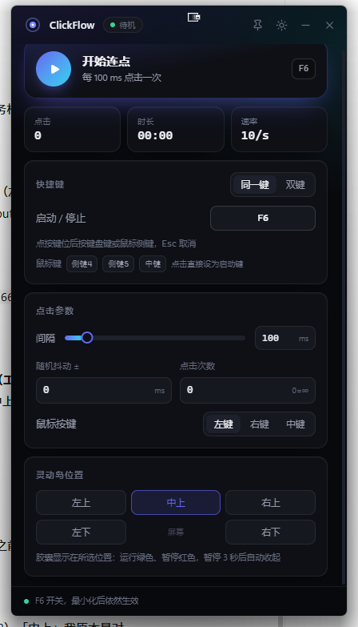
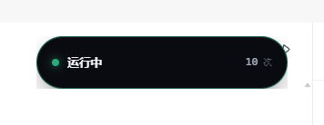
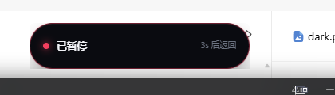
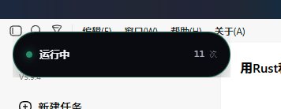
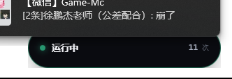

<div align="center">

# ClickFlow

**轻量、极速的 Windows 连点器**

毫秒级精准点击 · 全局热键 · 鼠标侧键 · 灵动岛状态显示

[](#)
[](https://tauri.app)
[](https://www.rust-lang.org)
[](https://react.dev)
[](../../releases)
[](#-许可)

</div>

<div align="center">

[](https://github.com/166AWA/ClickFlow-/releases/latest/download/ClickFlow.exe)

</div>



---

## 简介

ClickFlow 是一个用 **Rust + Tauri v2** 写的 Windows 连点器。后端直接调用 Win32 `SendInput` 注入鼠标事件，没有多余的输入库开销；前端用 React 构建，界面轻、启动快、占用低。

它解决的核心问题很简单：**要快、要稳、要能盲操**。所以你可以在任意窗口里用全局热键（甚至鼠标侧键）随时开关，不用切回主界面。

---

## 功能特性

- **毫秒级精度**：`SendInput` 一次投递按下 + 抬起；等待用 `timeBeginPeriod(1)` + 最后约 1ms 自旋收尾，避开 Windows 定时器抖动。
- **灵活频率**：点击间隔 `1ms ~ 600000ms`，支持随机抖动 `±`，可选点击次数上限（`0 = 无限`）。
- **全局热键**：键盘组合键，或**鼠标侧键 / 中键**；支持「同一键切换」与「启动 / 停止双键」两种模式。
- **录制即绑**：点一下键位按钮，按下目标键即可绑定；录制期间自动摘掉全局热键，避免误触发。
- **鼠标按键可选**：左键 / 右键 / 中键。
- **界面贴心**：无边框、可置顶、深浅色主题切换、最小化后热键依然生效、设置自动持久化。
- **灵动岛状态**：与 eIsland 联动，运行显示绿色、暂停显示红色，3 秒后自动让位给默认灵动岛（见下）。

---

## 下载与运行

**[⬇ 下载 ClickFlow.exe（最新版）](https://github.com/166AWA/ClickFlow-/releases/latest/download/ClickFlow.exe)**

> 当前版本 **v1.0.0** · 前往 [Releases](../../releases) 查看全部版本与更新日志。

1. 下载 `ClickFlow.exe`（单文件，免安装）。
2. 双击运行。
3. 默认热键为 **F6**（同一键开关）；按下即开始连点，再按停止。

> 首次运行若热键被其他程序占用，界面会给出提示，换一个键即可。
>
> 程序未做代码签名，Windows 可能弹出 SmartScreen 提示，点「更多信息 → 仍要运行」即可。

---

## 使用方法

### 快捷键

| 模式 | 启动 | 停止 |
| --- | --- | --- |
| 同一键（默认） | `F6` | `F6` |
| 双键 | `F6` | `F7` |

- 点快捷键卡片里的键位按钮后，按下键盘任意键或**鼠标侧键 / 中键**即可绑定，`Esc` 取消。
- 也可以直接点卡片底部的 `侧键4 / 侧键5 / 中键` 一键设为启动键。

### 点击参数

- **间隔**：每次点击的间隔（毫秒）。
- **随机抖动 ±**：在间隔基础上随机浮动，模拟更自然的点击节奏。
- **点击次数**：达到次数后自动停止，`0` 表示不限次数。
- **鼠标按键**：左键 / 右键 / 中键。

---

## 灵动岛（eIsland）集成

ClickFlow 会在屏幕顶部叠一个**透明、置顶、鼠标穿透**的胶囊，把连点状态直接显示在灵动岛位置：

| 状态 | 显示 |
| --- | --- |
| 运行中 | 🟢 绿色胶囊 + 实时点击次数 |
| 已暂停 | 🔴 红色胶囊「已暂停 · 3s 后返回」 |

暂停 **3 秒后自动收起**，让位给 eIsland 的默认灵动岛；再次运行会重新出现。

<p align="center">
  
  
</p>

### 位置可调

主界面底部「灵动岛位置」提供 5 个方位，点击即时生效并持久化：

```
[ 左上 ] [ 中上 ] [ 右上 ]
[ 左下 ] [ 屏幕 ] [ 右下 ]
```

<p align="center">
  
  
</p>

- **四角**：按 Windows 工作区计算，自动避开任务栏。
- **中上**：优先**动态对齐 eIsland 默认岛**（读取其窗口矩形，岛移动也能跟随）；未检测到 eIsland 时回落到屏幕顶部居中。

> 该功能依赖本机已运行的 [eIsland](https://github.com/)（或同名灵动岛应用）。未安装时其余功能不受影响。

---

## 从源码构建

### 环境要求

- Windows 10 / 11
- [Node.js](https://nodejs.org/) 18+
- [Rust](https://www.rust-lang.org/tools/install) 1.77.2+
- Visual Studio Build Tools（C++ 桌面开发）

### 构建

```bash
# 安装依赖
npm install

# 开发模式（热重载）
npm run tauri dev

# 生产构建
npm run tauri build
```

构建产物：`src-tauri/target/release/clickflow.exe`

---

## 技术栈

| 层 | 技术 |
| --- | --- |
| 桌面框架 | Tauri v2 |
| 后端 | Rust（Win32 `SendInput` / `WH_MOUSE_LL` 低级钩子） |
| 前端 | React 19 + Vite + Tailwind CSS v4 |
| 图标 | lucide-react |
| 全局热键 | tauri-plugin-global-shortcut |

### 项目结构

```
clickflow/
├─ src/                 # React 前端（主界面 + 灵动岛胶囊）
│  ├─ App.tsx
│  ├─ island.tsx
│  └─ lib/
├─ src-tauri/
│  ├─ src/main.rs       # Rust 后端：点击线程、热键、鼠标钩子、灵动岛窗口
│  └─ tauri.conf.json
├─ island.html          # 灵动岛独立页面入口
├─ index.html           # 主界面入口
└─ docs/                # README 截图
```

---

## 已知限制

- **仅支持 Windows**：依赖 Win32 API。
- **侧键被驱动改写**：部分鼠标把侧键映射成中键或键盘键，需在厂商驱动里改回「后退 / 前进」，ClickFlow 才能识别为侧键。
- **注入点击**：事件通过 `SendInput` 注入，不带真实硬件特征；极少数带反作弊的游戏可能拦截。
- **单实例**：同一时间只运行一个实例，全局热键独占。

---

## 许可

本项目基于 [MIT License](LICENSE) 开源，欢迎 issue 与 PR。
